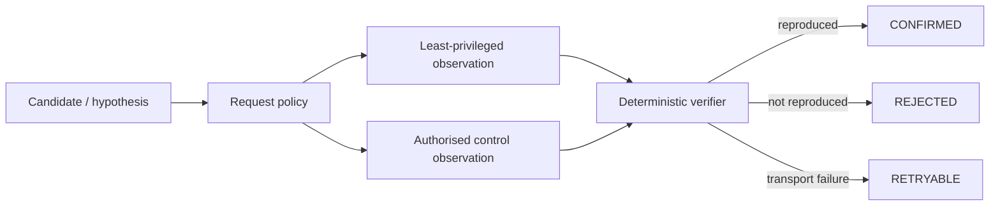

# Security Validation Harness

A small, runnable portfolio edition of a closed-loop security-validation
workflow. It shows how a security automation can make a candidate actionable
only after deterministic checks reproduce the condition and account for
failures explicitly.

> Designed exclusively for authorised testing against controlled lab
> environments and mock targets.

The operational system that inspired this repository remains private. This
edition contains no credentials, private infrastructure, target data, or live
network client.

## What this demonstrates

- A central request policy: REST probes are limited to `GET` and `HEAD`, and
  GraphQL operations must be queries.
- A deterministic verification stage that compares a least-privileged result
  with an authorised control result before confirming a candidate.
- Explicit outcome accounting: a transport failure is retryable, never a quiet
  negative result.
- A small, repeatable mock target so reviewers can run the workflow locally.



## Run it

Requires Python 3.11 or newer and no third-party packages.

```bash
python3 demo.py
python3 -m unittest discover -s tests -v
```

The demo uses an in-memory scripted transport. It never opens a network
connection.

## Design decisions

### Agentic judgement stays outside the proof boundary

An assistant can help prioritise hypotheses or summarise public source code,
but it does not get authority to declare a finding. Deterministic code acquires
the relevant observations, compares them with a control, and assigns the
verdict. That makes the result testable and keeps the proof boundary stable as
models change.

### Failure is an outcome, not an absence of evidence

If either observation fails to arrive, the verifier returns `RETRYABLE`.
Treating a transport error as a quiet miss hides outages and can produce false
assurance.

### Confirmations require a control

The synthetic confirmation requires the same, exact sensitive marker in both
the least-privileged response and an authorised control response. A marker
found only in a fixture, a missing control, or mismatched responses cannot
become a confirmation.

## Quality gates

The test suite mirrors four useful layers from the larger system:

- **Contract tests** keep the request-policy boundary narrow.
- **Fuzz tests** exercise method and operation variations around that boundary.
- **Process tests** cover the full candidate-to-verdict path.
- **Input-fuzz tests** ensure arbitrary response text cannot bypass the
  deterministic marker check.

GitHub Actions runs all four layers on every push and pull request.

## Repository layout

```text
harness/policy.py       request and GraphQL operation policy
harness/verification.py deterministic control comparison and verdicts
harness/transport.py    in-memory transport used by the demo and tests
demo.py                 a complete mock-only run
tests/                  contract, fuzz, process, and input-fuzz checks
```

## Scope and responsible use

This repository is an engineering example, not a scanner or an exploit tool.
Only use security validation techniques against systems you own or are
explicitly authorised to test.
